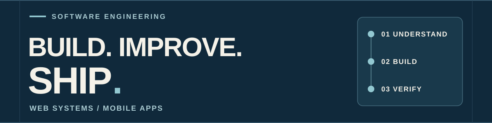

  

# 話を聞く。しくみを組む。動くところまで。

業務システムの改修・データ移行、Webサービス、iOS・Androidアプリを手がけるITエンジニアです。  
要件の整理から設計、実装、検証、公開後の改善まで対応しています。

**[ポートフォリオを見る](https://en-nagaojunichi.github.io/)** · **[開発について相談する](https://en-nagaojunichi.github.io/#contact)**

## 01 / 対応できること

- **既存システムを調べて直す** — コードやデータを読み解き、仕様の整理、機能改修、バージョン更新を進めます。
- **データを安全に移す** — 移行元・移行先の項目照合から処理の実装、移行後の整合性確認まで担当します。
- **Webサービスをつくる** — 画面、API、DB、認証・権限、テスト、公開・運用まで一つの流れで考えます。
- **スマホアプリを届ける** — FlutterでiOS・Androidアプリを開発し、両ストアへの公開と運用を経験しています。

## 02 / 担当した仕事と公開中の開発

### 既存業務システムのデータ移行・改修

既存データと移行先の設計を照合して仕様を整理し、Laravelによる移行処理の実装と結果の検証を担当しました。別案件では、Laravel 6から12への機能移植、認証機能、既存不具合の修正に対応しました。顧客案件のため、システム名や画面は公開していません。  
[担当範囲を見る](https://en-nagaojunichi.github.io/#works)

### MameAd — 店舗・事業者向けWebサービス

事業紹介ページ、15秒PR動画、SNS画像、投稿文を作成できるサービスです。画面、DB、生成処理、通知、権限管理を設計・実装し、本番運用しています。  
`PHP` `Laravel` `Vue` `MySQL` `Queue`  
[開発事例](https://en-nagaojunichi.github.io/projects/mamead.html) · [公開サービス](https://mamead.mameoffice.com/)

### iOS・Androidアプリ — 企画からストア公開まで

Flutterで開発し、両ストアで公開しています。  
[アプリ開発事例](https://en-nagaojunichi.github.io/projects/flutter.html)

| アプリ | App Store | Google Play |
| --- | --- | --- |
| パシャコマ — 写真から漫画を作成 | [iOS](https://apps.apple.com/jp/app/id6805789148) | [Android](https://play.google.com/store/apps/details?id=com.mameoffice.pashakoma) |
| いつでもクラシック — 音楽再生・オフライン保存 | [iOS](https://apps.apple.com/jp/app/id6748042662) | [Android](https://play.google.com/store/apps/details?id=com.itsudemoclassic) |
| 金庫スプリント — 金庫を開けるカジュアルゲーム | [iOS](https://apps.apple.com/jp/app/id6810457234) | [Android](https://play.google.com/store/apps/details?id=com.mameoffice.kinkosprint) |

### Next.js・TypeScriptによる画面とAPI

要件のすり合わせから内部設計、画面・API・DBの実装まで担当した経験があります。下記は技術と画面構成を伝えるために新しく制作した公開用サンプルです。顧客案件の画面・データは使用していません。  
`TypeScript` `React` `Next.js`  
[公開用サンプルを見る](https://en-nagaojunichi.github.io/projects/nextjs.html)

## 03 / 主な技術

| 領域 | 技術 |
| --- | --- |
| Web・API | PHP、Laravel、TypeScript、Next.js、React、Vue |
| アプリ | Flutter、Dart |
| データ・運用 | MySQL、PostgreSQL、Docker、AWS、GitHub Actions |
| テスト・品質 | PHPUnit、Pest、Larastan |

## 04 / 仕事の進め方

1. 現状、困っていること、完成条件を確認する
2. 既存のコード・データ・業務の流れを調べる
3. 影響範囲を共有してから実装する
4. 動作とデータを確認し、変更内容を引き継げる形で残す

仕様が曖昧な段階からの相談や、既存システムの調査・引き継ぎにも対応します。  
**[実績と連絡先を見る](https://en-nagaojunichi.github.io/)**
