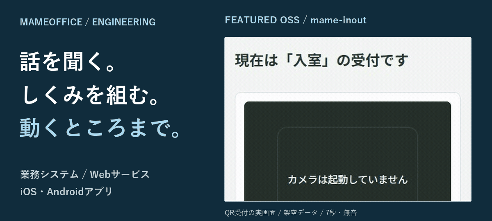
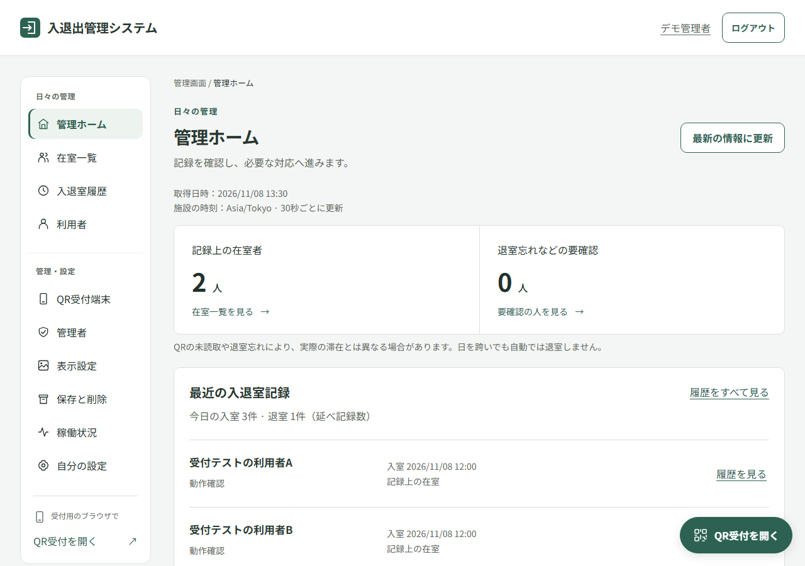
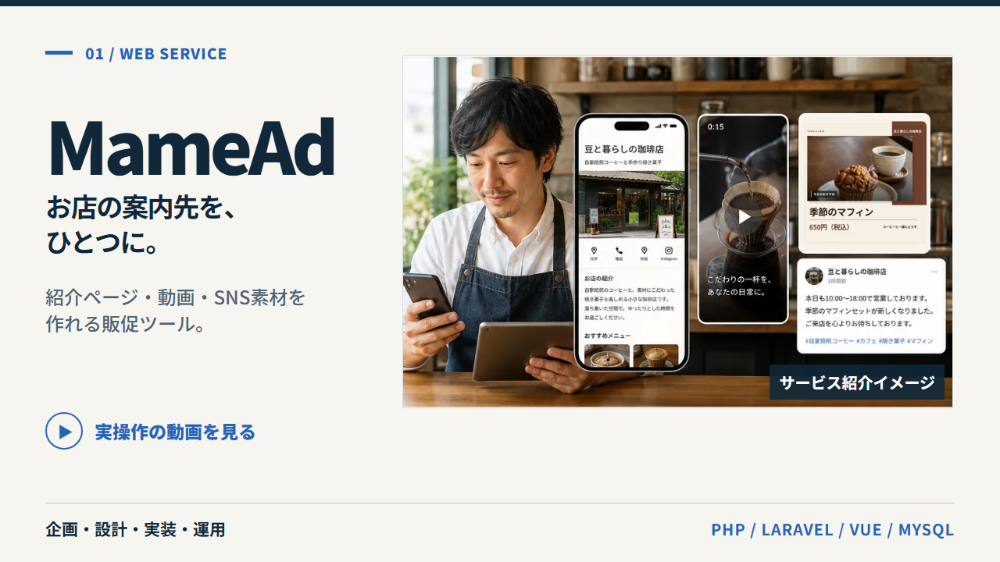
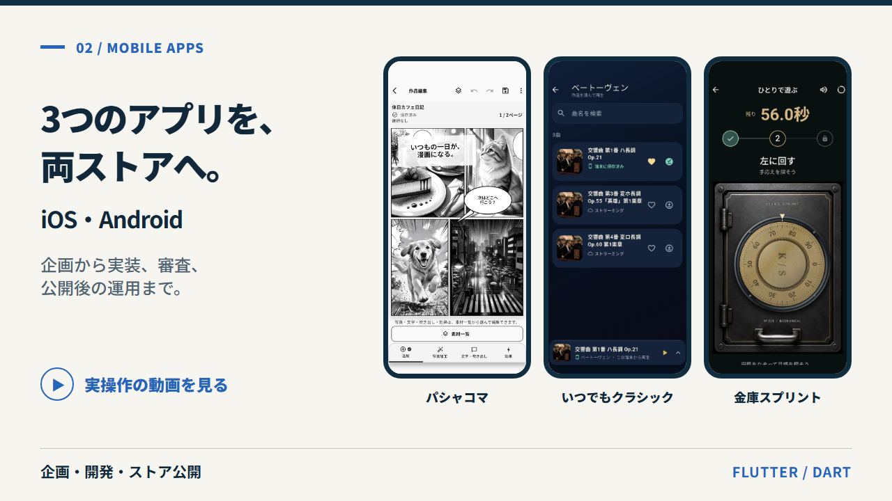

  

<picture>
  <source media="(prefers-reduced-motion: reduce) and (max-width: 600px)" srcset="assets/profile-hero-mobile-static.png" />
  <source media="(prefers-reduced-motion: reduce)" srcset="assets/profile-hero-static.png" />
  <source media="(max-width: 600px)" srcset="assets/profile-hero-mobile.gif" />
  
</picture>

# MameOffice / mameo

業務システムの改修・データ移行、Webサービス、iOS・Androidアプリを手がけるITエンジニアです。  
要件の整理から設計、実装、検証、公開後の改善まで対応しています。

**[OSSのソースコードを見る](https://github.com/mameoffice/mame-inout)** · **[開発記事を読む](https://zenn.dev/mameoffice/articles/55fdd020246691)** · **[ポートフォリオを見る](https://en-nagaojunichi.github.io/)**

冒頭のGIFは架空データとテスト用カメラによる操作例（7秒・無音）です。

## mame-inout — スマホとQRで使う入退出管理OSS

入口のスマホで個人QRを読み取り、入室・退室の時刻と記録上の在室者を確認する、無料のセルフホスト型ソフトウェアです。学習塾・自習室・習い事教室、小規模な事業所などでの利用を想定しています。

管理者のパスキー認証、受付端末の承認、履歴の訂正・CSV出力に対応。画面・API・DBを実装し、管理者と受付端末の権限分離、二重送信・同時操作への対応を設計しています。

`Next.js` `React` `TypeScript` `Hono` `PostgreSQL` `Prisma` `Docker Compose`

**[公開ソースコード・利用ガイド](https://github.com/mameoffice/mame-inout)** · [開発事例・操作動画](https://en-nagaojunichi.github.io/projects/mameinout.html)

[▶ 入室・退室から履歴確認までの操作デモを見る（約1分56秒・音声付き）](https://github.com/mameoffice/mame-inout/blob/main/docs/videos/overview.mp4)

現在は開発中です。画面・動画には架空データを使用しています。導入・運用条件と動画の収録方法・クレジットは[リポジトリ](https://github.com/mameoffice/mame-inout#readme)に記載しています。

## 関連記事 / Articles

**[Next.js + Hono + パスキー認証でQR入退出管理システムを作った話【OSS公開】](https://zenn.dev/mameoffice/articles/55fdd020246691)**

画面とAPIをどう分けたか、パスキーをどう組み込んだか、二重送信をどう扱うか。アーキテクチャの選定から実装・検証まで、開発で考えたことをZennにまとめました。

## ほかの公開サービス・アプリ

### MameAd — 店舗・事業者向けWebサービス

事業紹介ページ、15秒PR動画、SNS画像、投稿文を作成できるサービスです。画面、DB、生成処理、通知、権限管理を設計・実装し、本番運用しています。  
`PHP` `Laravel` `Vue` `MySQL` `Queue`  
[開発事例](https://en-nagaojunichi.github.io/projects/mamead.html) · [公開サービス](https://mamead.mameoffice.com/)

[▶ MameAdの実操作動画を見る](https://en-nagaojunichi.github.io/assets/videos/mamead-demo.mp4)

### iOS・Androidアプリ — 企画からストア公開まで

Flutterで開発し、両ストアで公開しています。  
[アプリ開発事例](https://en-nagaojunichi.github.io/projects/flutter.html)

[▶ アプリ3本の実画面動画を見る](https://en-nagaojunichi.github.io/assets/videos/apps-demo.mp4)

| アプリ | App Store | Google Play |
| --- | --- | --- |
| パシャコマ — 写真から漫画を作成 | [iOS](https://apps.apple.com/jp/app/id6805789148) | [Android](https://play.google.com/store/apps/details?id=com.mameoffice.pashakoma) |
| いつでもクラシック — 音楽再生・オフライン保存 | [iOS](https://apps.apple.com/jp/app/id6748042662) | [Android](https://play.google.com/store/apps/details?id=com.itsudemoclassic) |
| 金庫スプリント — 金庫を開けるカジュアルゲーム | [iOS](https://apps.apple.com/jp/app/id6810457234) | [Android](https://play.google.com/store/apps/details?id=com.mameoffice.kinkosprint) |

### Next.js・TypeScriptによる画面とAPI

要件のすり合わせから内部設計、画面・API・DBの実装まで担当した経験があります。下記は技術と画面構成を伝えるために新しく制作した公開用サンプルです。顧客案件の画面・データは使用していません。  
`TypeScript` `React` `Next.js`  
[公開用サンプルを見る](https://en-nagaojunichi.github.io/projects/nextjs.html)

## 対応できること

- **既存システムを調べて直す** — コードやデータを読み解き、仕様の整理、機能改修、バージョン更新を進めます。
- **データを安全に移す** — 移行元・移行先の項目照合から処理の実装、移行後の整合性確認まで担当します。
- **Webサービスをつくる** — 画面、API、DB、認証・権限、テスト、公開・運用まで一つの流れで考えます。
- **スマホアプリを届ける** — FlutterでiOS・Androidアプリを開発し、両ストアへの公開と運用を経験しています。

### 既存業務システムのデータ移行・改修

既存データと移行先の設計を照合して仕様を整理し、Laravelによる移行処理の実装と結果の検証を担当しました。別案件では、Laravel 6から12への機能移植、認証機能、既存不具合の修正に対応しました。顧客案件のため、システム名や画面は公開していません。
[担当範囲を見る](https://en-nagaojunichi.github.io/#works)

## 主な技術

| 領域 | 技術 |
| --- | --- |
| Web・API | PHP、Laravel、TypeScript、Next.js、React、Vue、Hono |
| アプリ | Flutter、Dart |
| データ・運用 | MySQL、PostgreSQL、Prisma、Docker、AWS、GitHub Actions |
| テスト・品質 | PHPUnit、Pest、Larastan、Vitest、Playwright |

## 仕事の進め方

1. 現状、困っていること、完成条件を確認する
2. 既存のコード・データ・業務の流れを調べる
3. 影響範囲を共有してから実装する
4. 動作とデータを確認し、変更内容を引き継げる形で残す

仕様が曖昧な段階からの相談や、既存システムの調査・引き継ぎにも対応します。  
**[開発について相談する](https://en-nagaojunichi.github.io/#contact)** · **[実績と連絡先を見る](https://en-nagaojunichi.github.io/)**
